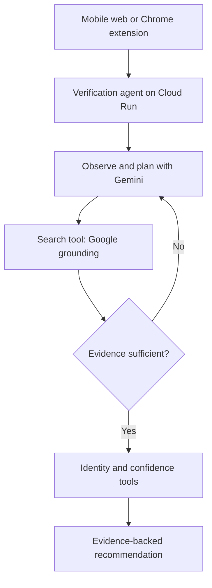

# KiasuCheck

**Check first. Trust smarter.**

KiasuCheck is an AI trust layer for the internet. Its hackathon MVP focuses on shopping: a shopper can paste a product name or URL, upload a screenshot, or use the Chrome extension while browsing. Gemini extracts an exact product fingerprint, searches publicly indexed listings, and explains which offers are truly comparable.

KiasuCheck does **not** claim direct access to Shopee, Lazada, or TikTok Shop APIs. Live results come from Grounding with Google Search and are labelled as public indexed snapshots.

## AI agent

The **KiasuCheck Shopping Verification Agent** observes an unstructured listing, creates a cross-platform investigation plan, uses Google Search grounding as a tool, evaluates whether the evidence is sufficient, and refines its search once when necessary. Deterministic tools then verify product identity and compare only supported prices. The API returns the agent's tool usage, investigation count, evidence confidence, and decision trace.

The agent is deliberately human-in-the-loop: it cannot purchase a product or claim that two storefronts have the same legal owner. It presents evidence and uncertainty for the shopper's decision.

## Why it matters

Price comparison often fails at product identity. A cheaper result may be another generation, storage size, bundle, colour, warranty type, or accessory. KiasuCheck scores identity before price and exposes uncertainty instead of silently presenting a false bargain.

The wider product vision applies the same evidence-first pattern to seller, scam, news, and AI-generated media checks. Those future checks are a roadmap, not capabilities claimed by this MVP.

## Demo surfaces

- Mobile-first web application for screenshots, URLs, and product descriptions
- Manifest V3 Chrome extension for checking the product page currently being viewed
- Explicit demo-data switch/fallback so a three-minute presentation does not depend on marketplace indexing

## Architecture



The deterministic scorer gives model-number and variant conflicts precedence over a low price. Product and seller similarity remain separate signals.

## Run locally

```bash
python3 -m venv .venv
. .venv/bin/activate
pip install -r requirements-dev.txt
export GOOGLE_CLOUD_PROJECT=gen-lang-client-0509152597
export GOOGLE_CLOUD_LOCATION=global
export GOOGLE_GENAI_USE_VERTEXAI=True
gcloud auth application-default login
uvicorn app.main:app --reload --port 8080
```

Open <http://localhost:8080>. Live failures remain visible unless the optional labelled demo fallback is enabled. You can explicitly request the stable demonstration path from the Chrome extension.

## Chrome extension

1. Open `chrome://extensions` and enable **Developer mode**.
2. Select **Load unpacked** and choose the `extension` directory.
3. Open a Shopee SG, Lazada SG, or TikTok Shop product page.
4. Click KiasuCheck in the Chrome toolbar.
5. Set the API URL through the gear icon (`http://localhost:8080` locally or the Cloud Run URL).

## Tests

```bash
pytest
```

The unit tests cover exact model matching, decisive mismatches, price savings, ranking, API health, demo results, and input validation.

## Deploy to Cloud Run

The deployment target defaults to:

- Project: `gen-lang-client-0509152597`
- Service: `shopproof`
- Region: `asia-southeast1`
- Gemini location: `global`
- Gemini model: `gemini-3.5-flash`

After authenticating `gcloud`, run:

```bash
./deploy.sh
```

The Cloud Run runtime service account needs `roles/aiplatform.user`. The deploying identity also needs permission to build images, deploy Cloud Run services, and act as the runtime service account.

## Configuration

| Variable | Default | Purpose |
|---|---|---|
| `GOOGLE_CLOUD_PROJECT` | `gen-lang-client-0509152597` | Vertex AI project |
| `GOOGLE_CLOUD_LOCATION` | `global` | Gemini API location |
| `GOOGLE_GENAI_USE_VERTEXAI` | `true` on Cloud Run | Use Vertex AI authentication (the code also sets `vertexai=True`) |
| `GEMINI_MODEL` | `gemini-3.5-flash` | Grounding-capable model |
| `KIASUCHECK_DEMO_FALLBACK` | `false` | Optional labelled demo fallback; disabled so live failures remain visible |
| `KIASUCHECK_MAX_AGENT_ITERATIONS` | `1` | Grounded search cycles; keep at one for interactive demo speed |
| `KIASUCHECK_VERSION` | `0.6.0` on deploy | Product version exposed by the health endpoint |
| `MAX_UPLOAD_BYTES` | `5242880` | Screenshot size limit |

## Honest limitations

- Search sees only pages available to Google's public index.
- Indexed price, stock, shipping, and voucher rules can be stale or personalized.
- Seller similarity is a clue, not legal proof that two storefronts share an owner.
- Some marketplaces may return sparse evidence or redirect URLs.
- The prototype is optimized for branded products with model numbers; fashion and unbranded goods are harder.

See [the agent specification](docs/AGENT.md), [architecture notes](docs/ARCHITECTURE.md), [three-minute demo script](docs/DEMO_SCRIPT.md), and [submission copy](docs/SUBMISSION.md).

