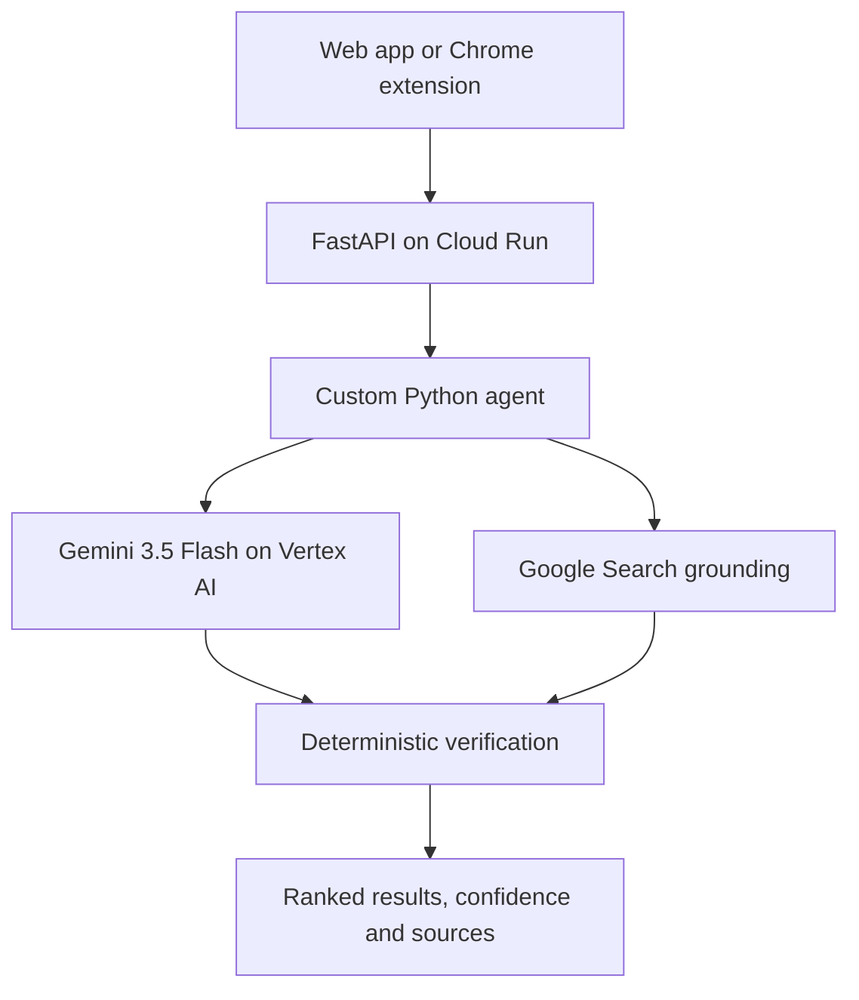

# KiasuCheck

**Check first. Trust smarter.**

KiasuCheck is an AI shopping verification agent that helps consumers avoid misleading deals across Shopee, Lazada, and TikTok Shop. A shopper can paste a product name or URL, upload a screenshot, or open the Chrome extension while browsing. KiasuCheck identifies the product and seller, investigates publicly indexed alternatives, verifies whether they are genuinely comparable, and explains the evidence behind every result.

KiasuCheck does **not** claim direct access to Shopee, Lazada, or TikTok Shop APIs. Live results come from Grounding with Google Search and are labelled as public indexed snapshots.

## Watch the demo

[](https://www.youtube.com/watch?v=aS6WRFCESjA)

**[Watch the demo video](https://www.youtube.com/watch?v=aS6WRFCESjA)** · **[Open the presentation deck](https://docs.google.com/presentation/d/15e65wnIdZWYBiAKdSFucySbuSp3kfoRwz2Ufe7swLTw/edit?usp=drivesdk)**

> GitHub does not render YouTube or Google Slides iframes inside a README. The preview and presentation link open the original content in a new page.

## What shoppers can check

- **Same shop + product:** look for the same seller and item on another platform.
- **Same product, any seller:** find exact product matches and compare supported prices.
- **Similar cheaper products:** discover lower-priced alternatives and expose important differences.

The original marketplace is excluded automatically. For example, a check started on Shopee targets Lazada and TikTok Shop.

## AI agent

The **KiasuCheck Shopping Verification Agent** is a custom Python agent implemented in `app/agent/kiasucheck_agent.py`; the MVP does not use Google ADK or Vertex AI Agent Engine. It:

1. observes text, URL metadata, or an optional screenshot;
2. asks Gemini to build a structured product fingerprint;
3. plans the selected comparison objectives and target marketplaces;
4. invokes Google Search grounding to discover current public evidence;
5. applies deterministic product, variant, and seller verification; and
6. ranks supported results and returns its trace and confidence scores.

The production default is one grounded investigation for interactive speed. The code supports additional iterations through configuration, but does not claim that a retry runs in the default deployment.

The agent is deliberately human-in-the-loop: it cannot purchase a product or claim that two storefronts have the same legal owner. It presents evidence and uncertainty for the shopper's decision.

## Why Google Cloud

- **Gemini 3.5 Flash on Vertex AI** provides multimodal product understanding, structured extraction, reasoning, and candidate analysis.
- **Google Search grounding** provides current, publicly indexed marketplace evidence and sources without pretending KiasuCheck has private marketplace APIs.
- **Cloud Run** hosts the FastAPI web application and agent as a serverless container with a five-minute request timeout and a maximum of three instances for the MVP.
- **Cloud Build** builds and deploys the application from source through `gcloud run deploy --source`.
- **Application Default Credentials and IAM** let Cloud Run call Vertex AI without exposing a Gemini API key to the browser or repository.

This Google-native combination connects Gemini's multimodal reasoning directly with grounded Google Search evidence and managed serverless deployment.

## Why it matters

Price comparison often fails at product identity. A cheaper result may be another generation, storage size, bundle, colour, warranty type, or accessory. KiasuCheck scores identity before price and exposes uncertainty instead of silently presenting a false bargain.

The wider product vision applies the same evidence-first pattern to seller, scam, news, and AI-generated media checks. Those future checks are a roadmap, not capabilities claimed by this MVP.

## Demo surfaces

- Mobile-first web application for screenshots, URLs, and product descriptions
- Manifest V3 Chrome extension for checking the product page currently being viewed
- Labelled presentation-data switch in the extension for a stable demonstration when live marketplace evidence is unavailable
- Persistent extension results, a repeat-comparison action, and a full-page comparison view

## Architecture



The deterministic scorer gives model-number and variant conflicts precedence over a low price. Product and seller similarity remain separate signals.

## Run locally

```bash
python3 -m venv .venv
. .venv/bin/activate
pip install -r requirements-dev.txt
export GOOGLE_CLOUD_PROJECT=gen-lang-client-0509152597
export GOOGLE_CLOUD_LOCATION=global
export GOOGLE_GENAI_USE_VERTEXAI=True
gcloud auth application-default login
uvicorn app.main:app --reload --port 8080
```

Open <http://localhost:8080>. Live failures remain visible unless the optional labelled demo fallback is enabled. You can explicitly request the stable demonstration path from the Chrome extension.

Deployed application: <https://shopproof-133701402785.asia-southeast1.run.app>

## Chrome extension

1. Open `chrome://extensions` and enable **Developer mode**.
2. Select **Load unpacked** and choose the `extension` directory.
3. Open a Shopee SG, Lazada SG, or TikTok Shop product page.
4. Click KiasuCheck in the Chrome toolbar.
5. Set the API URL through the gear icon (`http://localhost:8080` locally or the Cloud Run URL).

## Tests

```bash
pytest
```

The unit tests cover exact model matching, decisive mismatches, price savings, ranking, selected-objective filtering, same-seller enforcement, API health, demo results, and input validation.

## Deploy to Cloud Run

The deployment target defaults to:

- Project: `gen-lang-client-0509152597`
- Service: `shopproof`
- Region: `asia-southeast1`
- Gemini location: `global`
- Gemini model: `gemini-3.5-flash`

After authenticating `gcloud`, run:

```bash
./deploy.sh
```

The Cloud Run runtime service account needs `roles/aiplatform.user`. The deploying identity also needs permission to build images, deploy Cloud Run services, and act as the runtime service account.

## Configuration

| Variable | Default | Purpose |
|---|---|---|
| `GOOGLE_CLOUD_PROJECT` | `gen-lang-client-0509152597` | Vertex AI project |
| `GOOGLE_CLOUD_LOCATION` | `global` | Gemini API location |
| `GOOGLE_GENAI_USE_VERTEXAI` | `true` on Cloud Run | Use Vertex AI authentication (the code also sets `vertexai=True`) |
| `GEMINI_MODEL` | `gemini-3.5-flash` | Grounding-capable model |
| `KIASUCHECK_DEMO_FALLBACK` | `false` | Optional labelled demo fallback; disabled so live failures remain visible |
| `KIASUCHECK_MAX_AGENT_ITERATIONS` | `1` | Grounded search cycles; keep at one for interactive demo speed |
| `KIASUCHECK_VERSION` | `0.6.5` on deploy | Product version exposed by the health endpoint |
| `MAX_UPLOAD_BYTES` | `5242880` | Screenshot size limit |

## Honest limitations

- Search sees only pages available to Google's public index.
- Indexed price, stock, shipping, and voucher rules can be stale or personalized.
- Seller similarity is a clue, not legal proof that two storefronts share an owner.
- Some marketplaces may return sparse evidence or redirect URLs.
- Results without a resolvable direct product page are excluded; shop homepages and search pages are never presented as product evidence.
- The prototype is optimized for branded products with model numbers; fashion and unbranded goods are harder.

See [the agent specification](docs/AGENT.md), [architecture notes](docs/ARCHITECTURE.md), [three-minute demo script](docs/DEMO_SCRIPT.md), and [submission copy](docs/SUBMISSION.md).

